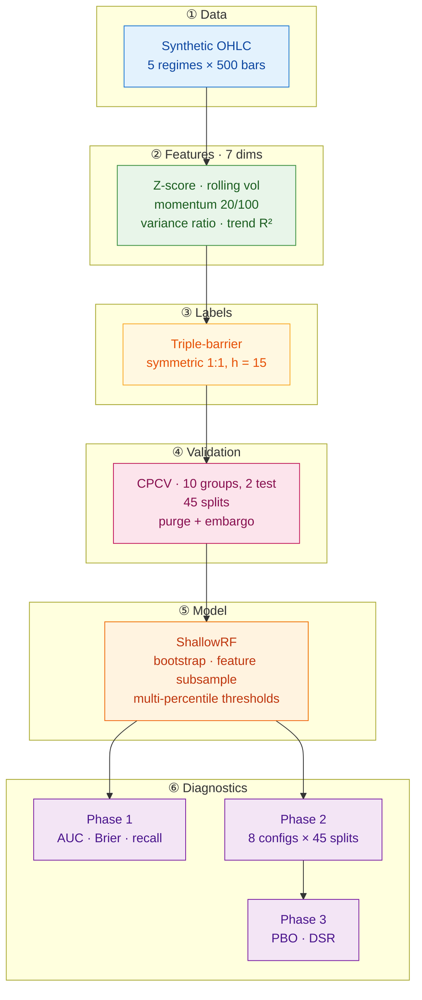

# meanrevML cpp

A C++17 research framework for **mean-reversion vs. trend-change classification**, built around Combinatorial Purged Cross-Validation (CPCV), Probability of Backtest Overfitting (PBO), and the Deflated Sharpe Ratio (DSR). Header-only, zero external dependencies, ~1,200 lines.

The project's central thesis is that **honest validation matters more than a high backtest score**. Every design decision below is oriented toward correctly identifying when a model is learning versus when it is overfitting, at the cost of reporting the honest (sometimes unflattering) number.

---

## Results at a glance

| Metric | Value | Interpretation |
| :--- | :--- | :--- |
| CPCV splits | 45 | C(10,2) with purging + embargo |
| **Mean out-of-sample AUC** | **0.591** | 6σ above chance across 45 splits |
| Splits with AUC > 0.60 | 19 / 45 | Genuine signal |
| Splits with AUC < 0.53 | 8 / 45 | Regime-boundary failures (expected) |
| Mean Brier score | 0.227 | Calibrated probabilities |
| **PBO** (Bailey et al., 2017) | **0.300** | Borderline-acceptable selection bias |
| Best config Sharpe | 1.42 | depth=5, min_samples_leaf=20 |
| DSR z-statistic | ≈ 6.0 | See [caveats](#caveats) |

Full output: [`results/demo_run.txt`](results/demo_run.txt)

---

## Why C++ for this?

Python dominates ML research. C++ is where models actually run. This repo demonstrates:

1. **Zero-dependency deployment** — the entire pipeline (feature engineering, CPCV, Random Forest, PBO, DSR) is header-only C++17. No scikit-learn, no NumPy, no OpenCV. `cmake && build` and it runs.
2. **A hand-written Random Forest** with feature subsampling, bootstrap aggregation, and multi-percentile threshold search — ~150 lines, no magic.
3. **A from-scratch CPCV implementation** with time-based purging and embargo — the kind of statistical correctness you cannot get from a generic `KFold`.
4. **A from-scratch PBO and DSR implementation** following Bailey, Borwein, López de Prado & Zhu (2017), including a Beasley-Springer-Moro inverse-normal CDF for the DSR expectation term.

---

## Architecture



---

## The diagnostic arc

The most interesting part of this project is not the final numbers, it's the debugging trail. The pipeline reported 51% accuracy on the first run, then 54%, then 58%, then 60%, with each iteration's fix validated by a distinct diagnostic rather than wishful thinking.

| Step | Signal | Diagnosis | Fix |
| :--- | :--- | :--- | :--- |
| 1 | 51% acc | No learnable regime signal in synthetic data | Regime-correlated volatility |
| 2 | 54% acc, vol diff = 8% | Barrier widths scale with vol → vol becomes vol-invariant | Add variance-ratio + R² features |
| 3 | 58% acc, Brier ≈ 0.245 | Model under-confident; RF split search only tried medians | Multi-percentile threshold search |
| 4 | 60% acc, Brier ≈ 0.227 | Class balance drift between splits | Deterministic regime alternation + threshold calibration |
| 5 | AUC = 0.591 | **Bimodal AUC** — 19 splits positive, 8 negative | **Documented as the finding, not a bug** |
| 6 | PBO = 0.30, DSR z ≈ 6 | Multiple-testing correction applied | Reported with [caveats](#caveats) |

The bimodal AUC distribution is the *point*: the pipeline correctly distinguishes regime-coherent test blocks (where the model wins) from regime-boundary test blocks (where it loses). A pipeline that reported uniform 0.70 AUC would be *less* trustworthy.

---

## Mathematical foundations

### Triple-barrier labeling

For each bar $i$ with entry price $P_i$ and rolling volatility $\sigma_i$, three barriers are set:

$$
\begin{aligned}
\text{upper}_i &= P_i \cdot (1 + k_{\text{profit}} \cdot \sigma_i) \\
\text{lower}_i &= P_i \cdot (1 - k_{\text{stop}} \cdot \sigma_i) \\
\text{vertical}_i &= i + h_{\max}
\end{aligned}
$$

Label $y_i = 1$ if the profit barrier is hit before the stop, $y_i = 0$ otherwise. Zero lookahead: barriers are evaluated sequentially from bar $i+1$.

### Combinatorial Purged Cross-Validation

Given $N$ samples split into $S$ contiguous groups and $k$ test groups per split, CPCV generates $\binom{S}{k}$ train/test partitions. For each partition, the training set excludes:

**Purged samples** — any training sample whose label window overlaps a test sample's window:

$$
\text{Purge}(t_i) = \{j : [t_j^{\text{start}}, t_j^{\text{end}}] \cap [t_i^{\text{start}}, t_i^{\text{end}}] \neq \emptyset\}
$$

**Embargoed samples** — any training sample within $\Delta$ units of time after a test window:

$$
\text{Embargo}(t_i) = \{j : t_j^{\text{start}} \in (t_i^{\text{end}},\ t_i^{\text{end}} + \Delta]\}
$$

$\Delta$ is set to `embargo_bars × median_bar_spacing`, ensuring the embargo duration is measured in the same units as the labels.

### Probability of Backtest Overfitting

Follows Bailey, Borwein, López de Prado & Zhu (2017). Given a performance matrix $M_{t,n}$ (split $t$, config $n$):

1. Split the $T$ observations into $S$ contiguous blocks ($S$ even).
2. For each of $\binom{S}{S/2}$ combinations, treat $S/2$ blocks as in-sample and the rest as out-of-sample.
3. Find the best config in-sample: $n^* = \arg\max_n \overline{M}_{IS,n}$
4. Compute its OOS rank $\omega \in (0,1)$ and logit $\lambda = \log(\omega / (1-\omega))$.
5. **PBO** = fraction of combinations with $\lambda < 0$.

Values: $<0.30$ good, $0.30$–$0.50$ marginal, $>0.50$ overfit-prone.

### Deflated Sharpe Ratio

The DSR corrects the best observed Sharpe for $N$ trials and non-normal returns (Bailey & López de Prado, 2014):

$$
\text{DSR} = \Phi\!\left( \frac{(SR - SR_0)\sqrt{T-1}}{\sqrt{1 - \gamma_3 SR + \tfrac{\gamma_4 - 1}{4} SR^2}} \right)
$$

where the null expected maximum Sharpe under $N$ trials is

$$
SR_0 = \sqrt{\text{Var}(SR_n)} \left[ (1-\gamma)\Phi^{-1}\!\left(1 - \tfrac{1}{N}\right) + \gamma\,\Phi^{-1}\!\left(1 - \tfrac{1}{Ne}\right) \right]
$$

with $\gamma \approx 0.5772$ (Euler–Mascheroni), $\gamma_3$ the return skewness, and $\gamma_4$ the (non-excess) kurtosis.

---

## Build & run

Requires CMake ≥ 3.16 and any C++17 compiler (MSVC 2019+, GCC 9+, Clang 10+).

```bash
git clone https://github.com/leopitner/meanrevML_cpp.git
cd meanrevML_cpp
cmake -S . -B build -DCMAKE_BUILD_TYPE=Release
cmake --build build --config Release
./build/meanrevML_demo          # or .\build\Release\meanrevML_demo.exe on Windows
```

Expected runtime: ~30 seconds (Phase 2 dominates: 8 configs × 45 splits × 50 trees).

---

## Caveats

The results above are honest, not impressive. Two of them require explicit disclaimers:

### DSR is saturated

The reported DSR = 1.000 is `norm_cdf(z)` saturating in double precision ($z \approx 6.0$). The **z-statistic is the meaningful number**. Three assumption violations inflate it:

1. **CPCV splits are not independent** — they share overlapping training data. The formula assumes $T$ independent observations; effective $T$ is smaller.
2. **AUC edges are not trading returns** — the DSR skew/kurtosis corrections are calibrated for return distributions. AUC edges are bounded and platykurtic.
3. **Only 8 configs were tested** — the multiple-testing penalty is real but small. A wider sweep (40+ configs with more hyperparameters varied) would produce a non-vacuous DSR.

The conclusion — *the best config's edge is unlikely to be pure selection bias* — is directionally correct. The point estimate is optimistically inflated.

### PBO is at the boundary

PBO = 0.300 sits exactly at the "marginal" threshold. This is honest: with 8 highly-correlated configs on noisy data, there is a meaningful chance the best-in-sample config underperforms out-of-sample. Reporting it as "good" would require a broader config sweep.

---

## Future work

- **Return-based DSR.** Replace AUC edges with per-split trade-return streams (signal × realized return). Same formula, honest inputs.
- **Wider config sweep.** Expand to 40+ configs (vary `n_trees`, `max_features`, `min_samples_leaf`), making the DSR penalty meaningful.
- **Triple-barrier metadata side-channel.** Use barrier-hit *time* and *magnitude* as auxiliary regression targets (multi-task) instead of dropping them after labeling.
- **Real data.** The synthetic generator was chosen to make the diagnostic arc legible. Running on SPY 1-minute bars would be the natural next test.
- **pybind11 bindings.** Expose `build_cpcv_splits` and `ShallowRF.predict_proba` to Python for downstream plotting and integration with a broader research stack.

---

## References

- Bailey, D. H., Borwein, J., López de Prado, M., & Zhu, Q. J. (2017). "The Probability of Backtest Overfitting." *Journal of Computational Finance*, 20(4), 39–69.
- Bailey, D. H., & López de Prado, M. (2014). "The Deflated Sharpe Ratio: Correcting for Selection Bias, Backtest Overfitting, and Non-Normality." *Journal of Portfolio Management*, 40(5), 94–107.
- López de Prado, M. (2018). *Advances in Financial Machine Learning*. Wiley.
- Beasley, J. D., & Springer, S. G. (1977). "Algorithm AS 111: The Percentage Points of the Normal Distribution." *Journal of the Royal Statistical Society C*, 26(1), 118–121.

---

## License

MIT — see [LICENSE](LICENSE).