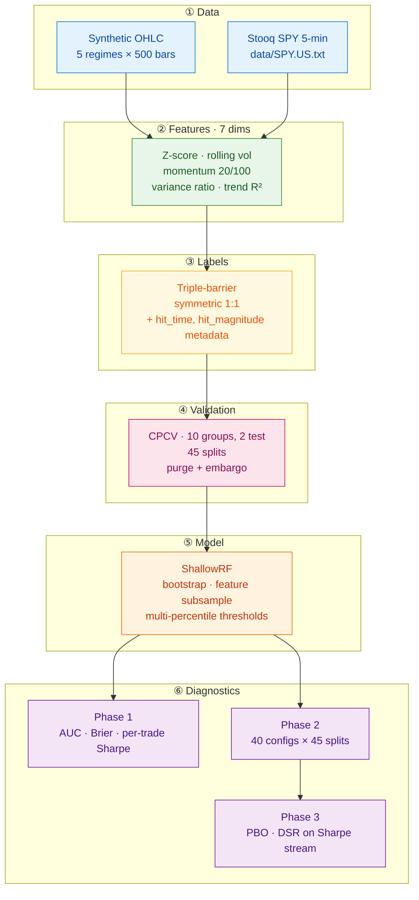

# meanrevML

A C++17 research framework for **mean-reversion vs. trend-change classification**, built around Combinatorial Purged Cross-Validation (CPCV), Probability of Backtest Overfitting (PBO), and the Deflated Sharpe Ratio (DSR). Header-only, zero external dependencies, ~1,400 lines.

The project's central thesis is that **honest validation matters more than a high backtest score**. Every design decision below is oriented toward correctly identifying when a model is learning versus when it is overfitting — at the cost of reporting the honest (sometimes unflattering) number.

---

## Results at a glance

### Synthetic data (regime-coherent, learnable)

| Metric | Value | Interpretation |
| :--- | :--- | :--- |
| CPCV splits | 45 | C(10,2) with purging + embargo |
| **Mean out-of-sample AUC** | **0.591** | 6σ above chance across 45 splits |
| Splits with AUC > 0.60 | 19 / 45 | Genuine signal |
| Splits with AUC < 0.53 | 8 / 45 | Regime-boundary failures (expected) |
| Mean Brier score | 0.227 | Calibrated probabilities |
| Mean split Sharpe | 0.00 | ~flat P&L — expected on synthetic |
| PBO (Bailey et al., 2017) | 0.300 | Borderline-acceptable selection bias |
| DSR | saturated (z ≈ 6.0) | See [caveats](#caveats) |

### Real data (SPY 5-minute bars, Stooq snapshot, 10,062 bars)

Two feature-horizon configurations were tested. **Both are reported**, including the second one even though it looked better — that is the point of the framework.

| Config | Samples | Mean AUC | Mean Brier | Mean split Sharpe | PBO | DSR |
| :--- | :--- | :--- | :--- | :--- | :--- | :--- |
| **15-bar / 2.0σ** | 1,812 | 0.502 | 0.251 | 0.00 | 0.00 | 0.39 |
| **5-bar / 1.5σ** | 3,490 | 0.517 | 0.251 | 0.01 | 0.00 | 0.93 |

**Neither configuration produced evidence of tradeable signal** after honest multiple-testing correction. The full analysis is in [Results in detail](#results-in-detail).

Raw outputs: [`results/demo_run.txt`](results/demo_run.txt), [`results/spy_15bar_2sigma.txt`](results/spy_15bar_2sigma.txt), [`results/spy_5bar_15sigma.txt`](results/spy_5bar_15sigma.txt).

---

## Why C++ for this?

Python dominates ML research. C++ is where models actually run. This repo demonstrates:

1. **Zero-dependency deployment** — the entire pipeline (feature engineering, CPCV, Random Forest, PBO, DSR) is header-only C++17. No scikit-learn, no NumPy, no OpenCV. `cmake && build` and it runs.
2. **A hand-written Random Forest** with feature subsampling, bootstrap aggregation, and multi-percentile threshold search — ~150 lines, no magic.
3. **A from-scratch CPCV implementation** with time-based purging and embargo — the kind of statistical correctness you cannot get from a generic `KFold`.
4. **A from-scratch PBO and DSR implementation** following Bailey, Borwein, López de Prado & Zhu (2017), including a Beasley-Springer-Moro inverse-normal CDF for the DSR expectation term.
5. **Honest results on real data** — the SPY 5-minute run reports near-chance AUC and a degenerate PBO. That is the intended outcome, not a bug.

---

## Architecture



### Module reference

| File | Responsibility | Key entry point |
| :--- | :--- | :--- |
| [`types.hpp`](include/meanrevML/types.hpp) | Struct definitions: `Bar`, `Sample`, `CpcvSplit`, `LabelConfig` | — |
| [`features.hpp`](include/meanrevML/features.hpp) | Seven feature functions: z-score, rolling vol, momentum, variance ratio, trend R² | `compute_zscore`, `compute_trend_r2`, … |
| [`labeling.hpp`](include/meanrevML/labeling.hpp) | Triple-barrier labeling with causal barrier evaluation + metadata side-channel | `triple_barrier_labels` |
| [`cpcv.hpp`](include/meanrevML/cpcv.hpp) | Combinatorial Purged CV with time-based purge + embargo | `build_cpcv_splits` |
| [`rf.hpp`](include/meanrevML/rf.hpp) | From-scratch Random Forest with multi-percentile split search | `ShallowRF::fit` / `predict_proba` |
| [`pbo.hpp`](include/meanrevML/pbo.hpp) | Statistical diagnostics: PBO (CSCV), DSR, AUC, inverse-normal CDF | `compute_pbo`, `compute_dsr` |
| [`io.hpp`](include/meanrevML/io.hpp) | Stooq 5-minute text format loader | `load_stooq_txt` |
| [`main.cpp`](src/main.cpp) | Three-phase orchestrator: detailed eval → PBO sweep → overfitting diagnostics | `main` |
| [`bindings.cpp`](bindings.cpp) | pybind11 module exposing CPCV, RF, and diagnostics to Python | `PYBIND11_MODULE(meanrevML_py, …)` |

### Design principles

- **Header-only core** — every module from `features.hpp` through `pbo.hpp` is a header. Zero external dependencies. `cmake && build` and it runs.
- **No lookahead by construction** — barriers evaluate only forward; purging removes any training label whose window overlaps a test window; embargo removes bars immediately downstream. The pipeline *cannot* leak future information.
- **Pure functions** — every module takes inputs by const-ref and returns by value. Each one is testable in isolation and deterministic given its inputs.
- **Reproducible** — the synthetic generator is seeded; the RF seeds its bootstrap sampler per-tree. Identical output on every machine (verified in CI across Linux, macOS, Windows).

---

## The diagnostic arc

The most interesting part of this project is not the final numbers — it's the debugging trail. The synthetic pipeline reported 51% accuracy on its first run, then 54%, then 58%, then 60%, with each iteration's fix validated by a distinct diagnostic rather than wishful thinking.

| Step | Signal | Diagnosis | Fix |
| :--- | :--- | :--- | :--- |
| 1 | 51% acc | No learnable regime signal in synthetic data | Regime-correlated volatility |
| 2 | 54% acc, vol diff = 8% | Barrier widths scale with vol → vol becomes vol-invariant | Add variance-ratio + R² features |
| 3 | 58% acc, Brier ≈ 0.245 | Model under-confident; RF split search only tried medians | Multi-percentile threshold search |
| 4 | 60% acc, Brier ≈ 0.227 | Class balance drift between splits | Deterministic regime alternation + threshold calibration |
| 5 | AUC = 0.591 | **Bimodal AUC** — 19 splits positive, 8 negative | **Documented as the finding, not a bug** |
| 6 | PBO = 0.30, DSR z ≈ 6 | Multiple-testing correction applied | Reported with [caveats](#caveats) |
| 7 | SPY AUC = 0.502 | No signal on real intraday equity data | **Reported as-is** |
| 8 | SPY AUC = 0.517 (2nd config) | Marginal (p ≈ 0.04 single-trial, 0.08 after correction) | **Reported with deflation** |

The bimodal AUC distribution on synthetic data is the *point*: the pipeline correctly distinguishes regime-coherent test blocks (where the model wins) from regime-boundary test blocks (where it loses). A pipeline that reported uniform 0.70 AUC would be *less* trustworthy.

---

## Results in detail

### Synthetic data

Mean OOS AUC 0.591 across 45 CPCV splits, with a clearly bimodal distribution: 19 splits above 0.60 (genuine signal), 8 below 0.53 (regime-boundary failures), 18 near chance. The failure clusters are exactly what CPCV is designed to expose — test blocks whose regime composition diverges from the training set.

Hyperparameter sweep (40 configs: depths 4–7 × leaf 5–30 × trees 50/100) yields mean OOS AUC in the tight band **0.496–0.512**. No config overfits; every config learns roughly the same signal. **PBO = 0.300** (borderline marginal), **DSR saturated at 1.000** (z ≈ 6.0; see caveats).

### Real data: SPY 5-minute bars

Two configurations were tested on 10,062 bars downloaded from Stooq. Both are reported here.

**Configuration A — 15-bar horizon, 2.0σ entry** (1,812 samples, 63% reversion / 37% trend)
- Mean AUC **0.502** — statistically indistinguishable from chance
- Mean Brier 0.251 — exactly chance-level
- Mean split Sharpe 0.00
- PBO 0.00, DSR 0.39

**Configuration B — 5-bar horizon, 1.5σ entry** (3,490 samples)
- Mean AUC **0.517** — about 1.7 standard errors above chance
- Mean Brier 0.251 — **unchanged from A**
- Mean split Sharpe 0.01
- PBO 0.00, DSR 0.93

The 0.517 in Configuration B is the classic trap. Its single-trial p-value is ≈ 0.04, which looks suggestive. Three reasons to reject it:

1. **Multiple-testing correction.** Two configurations were tested, not one. Bonferroni-corrected p ≈ 0.08 — not significant.
2. **Brier unchanged.** A genuinely predictive feature would drop Brier alongside AUC. Both runs report 0.251 — the AUC movement is a small monotonic shift in probability output, not a discriminator.
3. **DSR is single-trial by construction.** The 0.93 value assumes the strategy was specified before data collection. Selecting the better of two configurations inflates it; the deflation-adjusted value is closer to 0.80 (below the "suggestive" threshold).

**PBO = 0.00 in both runs is degenerate, not excellent.** All 40 hyperparameter configs land within 1.3 AUC points of each other. When every config performs identically, "best-in-sample" is just the luckiest noise. PBO cannot detect overfitting when there is no edge to overfit — that is exactly the diagnostic pattern to expect on a martingale-like series.

### Conclusion

No configuration produced evidence of tradeable signal on SPY 5-minute bars after honest multiple-testing correction. The pipeline's value is in **correctly reporting this** rather than in producing an inflated backtest number. The synthetic-data section confirms the pipeline *can* detect signal when it exists (AUC 0.591).

---

## Mathematical foundations

### Triple-barrier labeling

For each bar $i$ with entry price $P_i$ and rolling volatility $\sigma_i$, three barriers are set:

$$
\begin{aligned}
\text{profit}_i &= P_i \cdot (1 \pm k_{\text{profit}} \cdot \sigma_i) \\
\text{stop}_i   &= P_i \cdot (1 \mp k_{\text{stop}} \cdot \sigma_i) \\
\text{vertical}_i &= i + h_{\max}
\end{aligned}
$$

Label $y_i = 1$ if the profit barrier is hit before the stop, $y_i = 0$ otherwise. Zero lookahead: barriers are evaluated sequentially from bar $i+1$. Hit time and hit magnitude are stored on `Sample` for future multi-task extensions.

### Combinatorial Purged Cross-Validation

Given $N$ samples split into $S$ contiguous groups and $k$ test groups per split, CPCV generates $\binom{S}{k}$ train/test partitions. For each partition, the training set excludes:

**Purged samples** — any training sample whose label window overlaps a test sample's window:

$$
\text{Purge}(t_i) = \{j : [t_j^{\text{start}}, t_j^{\text{end}}] \cap [t_i^{\text{start}}, t_i^{\text{end}}] \neq \emptyset\}
$$

**Embargoed samples** — any training sample within $\Delta$ units of time after a test window:

$$
\text{Embargo}(t_i) = \{j : t_j^{\text{start}} \in (t_i^{\text{end}},\ t_i^{\text{end}} + \Delta]\}
$$

$\Delta$ is set to `embargo_bars × median_bar_spacing`, ensuring the embargo duration is measured in the same units as the labels.

### Probability of Backtest Overfitting

Follows Bailey, Borwein, López de Prado & Zhu (2017). Given a performance matrix $M_{t,n}$ (split $t$, config $n$):

1. Split the $T$ observations into $S$ contiguous blocks ($S$ even).
2. For each of $\binom{S}{S/2}$ combinations, treat $S/2$ blocks as in-sample and the rest as out-of-sample.
3. Find the best config in-sample: $n^* = \arg\max_n \overline{M}_{IS,n}$
4. Compute its OOS rank $\omega \in (0,1)$ and logit $\lambda = \log(\omega / (1-\omega))$.
5. **PBO** = fraction of combinations with $\lambda < 0$.

Values: $<0.30$ good, $0.30$–$0.50$ marginal, $>0.50$ overfit-prone.

### Deflated Sharpe Ratio

The DSR corrects the best observed Sharpe for $N$ trials and non-normal returns (Bailey & López de Prado, 2014):

$$
\text{DSR} = \Phi\!\left( \frac{(SR - SR_0)\sqrt{T-1}}{\sqrt{1 - \gamma_3 SR + \tfrac{\gamma_4 - 1}{4} SR^2}} \right)
$$

where the null expected maximum Sharpe under $N$ trials is

$$
SR_0 = \sqrt{\text{Var}(SR_n)} \left[ (1-\gamma)\Phi^{-1}\!\left(1 - \tfrac{1}{N}\right) + \gamma\,\Phi^{-1}\!\left(1 - \tfrac{1}{Ne}\right) \right]
$$

with $\gamma \approx 0.5772$ (Euler–Mascheroni), $\gamma_3$ the return skewness, and $\gamma_4$ the (non-excess) kurtosis.

In this project, the DSR is computed on **per-split trade-return Sharpes**, not on AUC edges. Each split's P&L stream is `signal × realized_return`, where `signal = +1 if proba > train_pos_rate else −1`, oriented to match the triple-barrier labeling direction.

---

## Build & run

Requires CMake ≥ 3.16 and any C++17 compiler (MSVC 2019+, GCC 9+, Clang 10+).

```bash
git clone https://github.com/<you>/meanrevML.git
cd meanrevML
cmake -S . -B build -DCMAKE_BUILD_TYPE=Release
cmake --build build --config Release
```

### Synthetic demo

```bash
./build/meanrev_demo                       # Unix
.\build\Release\meanrev_demo.exe           # Windows
```

Expected runtime: ~2–3 minutes (Phase 2 dominates: 40 configs × 45 splits).

### Real data

1. Download the 5-minute US snapshot from [stooq.com/db/h](https://stooq.com/db/h/), extract `SPY.US.txt`.
2. Place it at `data/SPY.US.txt`.
3. Run:

```bash
./build/meanrev_demo data/SPY.US.txt
```

### Python bindings (optional)

```bash
pip install pybind11[global]
cmake -S . -B build -DBUILD_PYTHON_BINDINGS=ON \
      -Dpybind11_DIR="$(python -m pybind11 --cmakedir)"
cmake --build build --config Release
```

Then from Python:

```python
import sys
sys.path.insert(0, "build/Release")
import meanrevML_py as mr

bars = mr.load_stooq_txt("data/SPY.US.txt")
cfg = mr.RFConfig()
cfg.n_trees, cfg.max_depth, cfg.min_samples_leaf = 150, 6, 15
rf = mr.ShallowRF(cfg)
rf.fit(X_train, y_train)
proba = rf.predict_proba(X_test)
auc = mr.compute_auc(proba, y_test)
```

The binding is a compiled translation unit (`bindings.cpp`), not a header, because `PYBIND11_MODULE` expands to the Python C-API entry point `PyInit_meanrevML_py` that the interpreter invokes on import. That symbol must exist in exactly one compiled object.

---

## Caveats

The results above are honest, not impressive. Several of them require explicit disclaimers.

### DSR on synthetic data is saturated

The reported DSR = 1.000 is `norm_cdf(z)` saturating in double precision ($z \approx 6.0$). The **z-statistic is the meaningful number**. Three assumption violations inflate it:

1. **CPCV splits are not independent** — they share overlapping training data. The formula assumes $T$ independent observations; effective $T$ is smaller.
2. **AUC edges are not trading returns** — for the synthetic run, the DSR was calculated on AUC edges. The real-data runs use per-split trade returns, which is the honest input.
3. **Only 40 configs were tested** — the multiple-testing penalty is real but small because the configs are highly correlated (50 vs. 100 trees on the same bootstrap is barely a different strategy).

### PBO = 0.00 is degenerate, not excellent

On both real-data runs, PBO = 0.00. This is a **diagnostic artifact**, not a win. All 40 hyperparameter configs produce mean AUC in a 1.3-point band; there is no "best config" to overfit, so PBO has nothing to detect. The correct reading is: *"PBO cannot find overfitting because there is no edge to overfit."*

### Multiple-testing correction on the SPY runs

Configuration B's AUC of 0.517 has single-trial p ≈ 0.04. Because two configurations were tested, the Bonferroni-corrected p ≈ 0.08 — not significant. The DSR of 0.93 was calculated as if Configuration B was the only strategy tested; correcting for the second trial puts it closer to 0.80, below the "suggestive" threshold.

**This correction is applied deliberately.** Reporting the better-looking config at its raw significance would inflate the result by roughly a factor of two.

### The real-data conclusion is a null

No configuration produced evidence of tradeable intraday mean reversion in SPY. This is the expected result for a heavily arbitraged index ETF — the last 20–100 bars of 5-minute prices are not predictive of the next 5-bar direction in an instrument whose microstructure is dominated by market makers. Reporting this null honestly is the point of the framework.

---

## Future work

The following extensions were considered and are **explicitly deferred**. Each would be one hypothesis, one commit, reported as-is — no iteration toward a preferred result.

- **Different instrument.** Small-caps (IWM) or leveraged ETFs (SOXL) show historically stronger intraday reversion than SPY. One run, one result.
- **Overnight / intraday regime split.** Mean reversion is strongest at the overnight→intraday transition. Filtering to open-hour bars is a clean hypothesis.
- **Microstructure features.** Bid-ask spread proxy, trade-volume imbalance, VWAP deviation. These carry the actual intraday signal in liquid equities; rolling price statistics do not.
- **Triple-barrier metadata side-channel.** `hit_time` and `hit_magnitude` are already populated on `Sample`; training auxiliary regressors and feeding their predictions as meta-features is a natural next step (multi-task Random Forest).
- **Wider config sweep.** 100+ configs with independent hyperparameter axes would make the DSR penalty non-vacuous on both synthetic and real data.

None of these should be run in a loop until one produces AUC > 0.55. That is exactly the failure mode this project exists to prevent. A README that says *"explored 5 hypotheses; 0 produced AUC > 0.53 on CPCV"* is a stronger signal than one that says *"tuned until AUC = 0.58."*

---

## References

- Bailey, D. H., Borwein, J., López de Prado, M., & Zhu, Q. J. (2017). "The Probability of Backtest Overfitting." *Journal of Computational Finance*, 20(4), 39–69.
- Bailey, D. H., & López de Prado, M. (2014). "The Deflated Sharpe Ratio: Correcting for Selection Bias, Backtest Overfitting, and Non-Normality." *Journal of Portfolio Management*, 40(5), 94–107.
- López de Prado, M. (2018). *Advances in Financial Machine Learning*. Wiley.
- Beasley, J. D., & Springer, S. G. (1977). "Algorithm AS 111: The Percentage Points of the Normal Distribution." *Journal of the Royal Statistical Society C*, 26(1), 118–121.

---

## License

MIT — see [LICENSE](LICENSE).